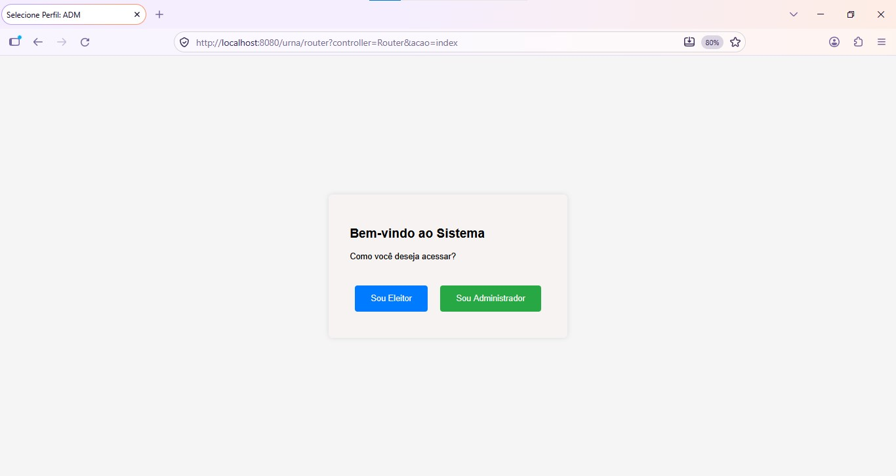
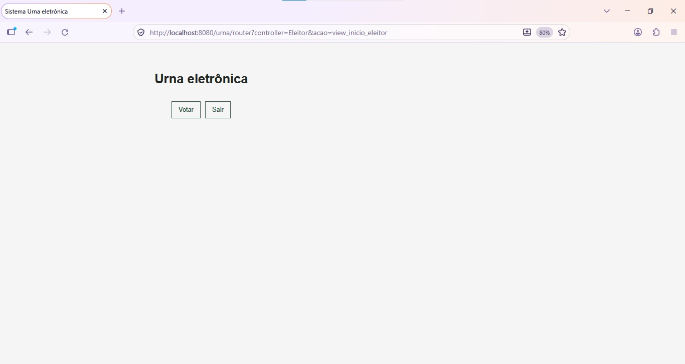
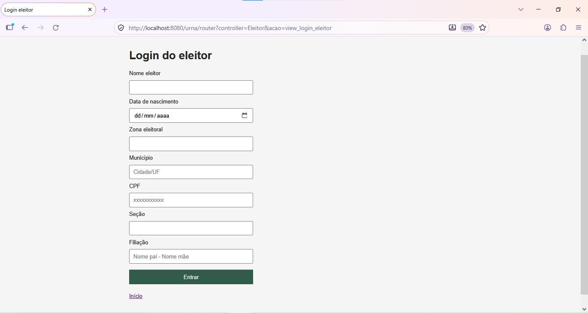
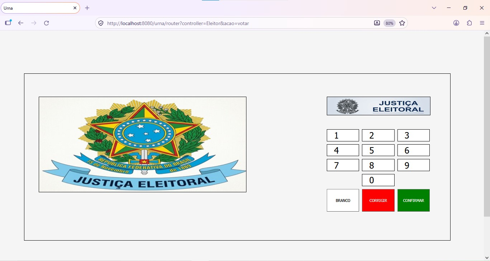

# Urna Eletrônica

Aplicação web em Java que simula uma votação. O sistema possui duas áreas de acesso: o eleitor se identifica e registra seu voto; o administrador consulta a apuração. A aplicação registra votos válidos, brancos ou nulos.

> **Aviso:** projeto acadêmico para fins de estudo. Não use em eleições reais. O banco relaciona cada voto ao eleitor, portanto não há sigilo do voto; além disso, a autenticação administrativa e as credenciais padrão não oferecem segurança adequada para produção.

## Tecnologias

- Java 17
- JSP e Jakarta Servlets
- Apache Tomcat 10.0
- MySQL e JDBC (MySQL Connector/J 8.0.28)
- HTML, CSS e JavaScript

O projeto está configurado como um projeto web do Eclipse. Não há `pom.xml` ou `build.gradle`; o driver JDBC já está incluído em `src/main/webapp/WEB-INF/lib`.

## Funcionalidades

- Autenticação do eleitor por nome, data de nascimento, zona, município, CPF, seção e filiação.
- Registro de voto válido por número de dois dígitos, voto em branco ou voto nulo quando o número não corresponde a uma candidatura cadastrada.
- Bloqueio de um segundo voto para o mesmo eleitor.
- Consulta administrativa dos votos válidos por candidatura e dos totais de votos válidos, brancos, nulos e registrados.

## Telas

As imagens são capturas do sistema e podem ser abertas em tamanho original clicando nelas.

<div align="center">
  <a href="outros/img/f1.jpg"></a>
</div>

<div align="center">
  <a href="outros/img/f2.jpg"></a>
</div>

<div align="center">
  <a href="outros/img/f3.jpg"></a>
</div>

<div align="center">
  <a href="outros/img/f4.jpg"></a>
</div>

## Banco de dados

O banco padrão é `eleicoes_presidenciais`. O script [`outros/sql-consulta_sql/sql2.sql`](outros/sql-consulta_sql/sql2.sql) cria o banco e as tabelas `eleitor`, `legenda` e `votacao`.

- `eleitor` guarda os dados usados na identificação. `idEleitor` é gerado pelo banco e `votou` indica se o eleitor já registrou seu voto (`0` ou `1`).
- `legenda` guarda o partido ou coligação, o número de votação e o nome do candidato. Esses três campos têm restrições de unicidade. O número é inteiro; use valores de `10` a `99`, pois a urna espera dois dígitos e números com zero à esquerda não são preservados pelo banco.
- `votacao` registra o voto confirmado. `eleitor_idEleitor` é único, impedindo mais de um registro por eleitor. `legenda_id` aponta para uma candidatura e fica `NULL` para votos brancos ou nulos. Em cada registro, um dos campos `votos_validos`, `votos_brancos` e `votos_nulos` recebe `1`, e os outros recebem `0`.

O script contém somente a estrutura do banco; ele não cadastra eleitores, candidatos ou votos. O sistema cria os registros de votação quando o eleitor confirma o voto e atualiza `eleitor.votou` na mesma transação. Não cadastre votos manualmente.

[`outros/sql-consulta_sql/Consulta.sql`](outros/sql-consulta_sql/Consulta.sql) contém exemplos para apurar votos por candidatura e calcular os totais gerais. As consultas utilizadas pela tela administrativa estão implementadas em `src/main/java/model/ADM_model.java`.

### Preparar os dados

Execute o script de estrutura em um banco vazio. Depois, cadastre as candidaturas e os eleitores aptos antes de testar a aplicação. Use dados fictícios em ambiente local.

Exemplo de cadastro de eleitor (a data deve estar no formato `AAAA-MM-DD`):

```sql
USE eleicoes_presidenciais;

INSERT INTO eleitor
    (nome, `data`, zona, municipio, cpf, secao, filiacao, votou)
VALUES
    ('Eleitor de Teste', '2000-01-15', '001', 'Cidade/UF',
     '00000000000', '001', 'Responsavel 1 - Responsavel 2', 0);
```

Exemplo de candidatura:

```sql
INSERT INTO legenda (partido_coligacao, numero_voto, nome_candidato)
VALUES ('Partido de Teste', 10, 'Candidatura de Teste');
```

No login, informe os dados de identificação conforme cadastrados no banco. Para registrar um voto válido, o número digitado deve estar associado a uma linha de `legenda`.

## Configuração da conexão

A conexão JDBC está em `src/main/java/config/Conecta.java`. Por padrão, usa:

- Endereço: `localhost:3306`
- Banco: `eleicoes_presidenciais`
- Usuário: `root`
- Senha: vazia

Altere os campos `URL`, `USUARIO` e `SENHA` nessa classe para corresponder à configuração local do MySQL. Não mantenha credenciais reais no controle de versão.

## Executar localmente

1. Instale Java 17, MySQL e Eclipse com suporte a projetos web (WTP).
2. Inicie o MySQL e execute `outros/sql-consulta_sql/sql2.sql` em um cliente, como MySQL Workbench ou HeidiSQL.
3. Ajuste a conexão em `config/Conecta.java` e insira os dados de teste descritos acima.
4. No Eclipse, importe o projeto existente e configure um runtime Apache Tomcat 10.0.
5. Execute o projeto com **Run As > Run on Server**.
6. Acesse o contexto publicado no navegador. Normalmente: `http://localhost:8080/urna/`. O contexto pode variar conforme a configuração do Tomcat.

O projeto usa anotações Servlet e não possui `web.xml`.

## Acesso administrativo

As credenciais padrão são usuário `ADM` e senha `1234`. É possível substituí-las pelas variáveis de ambiente `URNA_ADMIN_NOME` e `URNA_ADMIN_SENHA`, definidas no ambiente do processo Java antes de iniciar o Tomcat. Não use as credenciais padrão fora de uma demonstração local.

## Estrutura

- `src/main/java/config/`: conexão JDBC e filtro que restringe o fluxo do eleitor.
- `src/main/java/controller/`: roteamento e controladores de eleitor e administrador.
- `src/main/java/model/`: acesso ao banco e classes de dados.
- `src/main/webapp/view/`: páginas JSP do sistema.
- `src/main/webapp/css/` e `src/main/webapp/js/`: estilos e interação da urna.
- `src/main/webapp/img/`: imagens usadas pela interface da urna.
- `src/main/webapp/WEB-INF/lib/`: driver MySQL Connector/J.
- `outros/img/`: capturas de tela apresentadas neste README.
- `outros/sql-consulta_sql/`: scripts de estrutura e consultas SQL.
- `outros/sql-model/`: modelo visual do banco (`model.mwb` e imagem exportada).

## Autoria

Sander Gustavo Piva